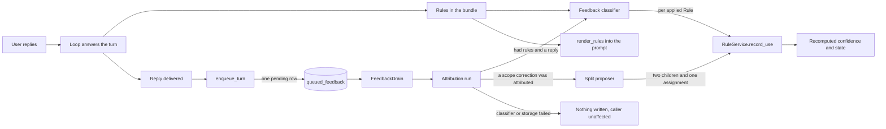
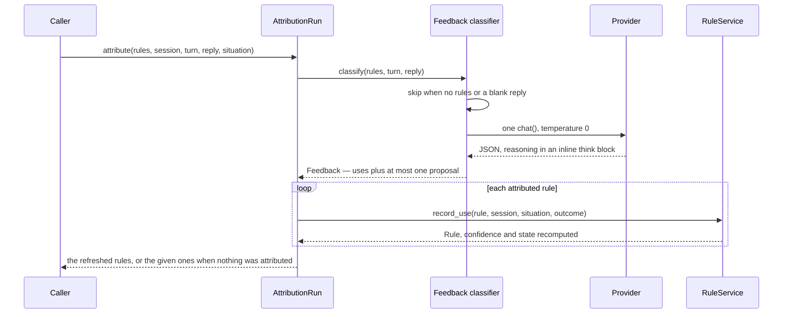
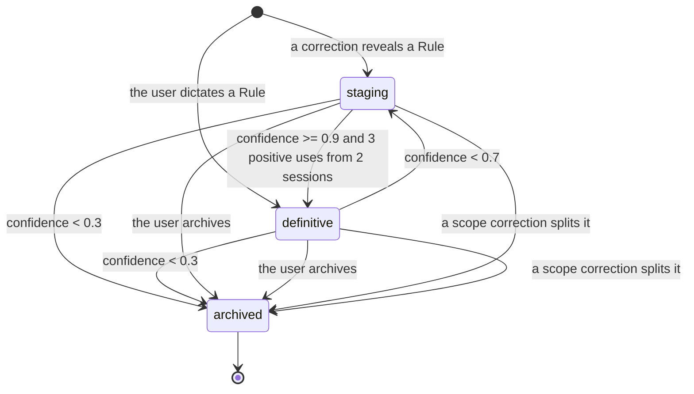
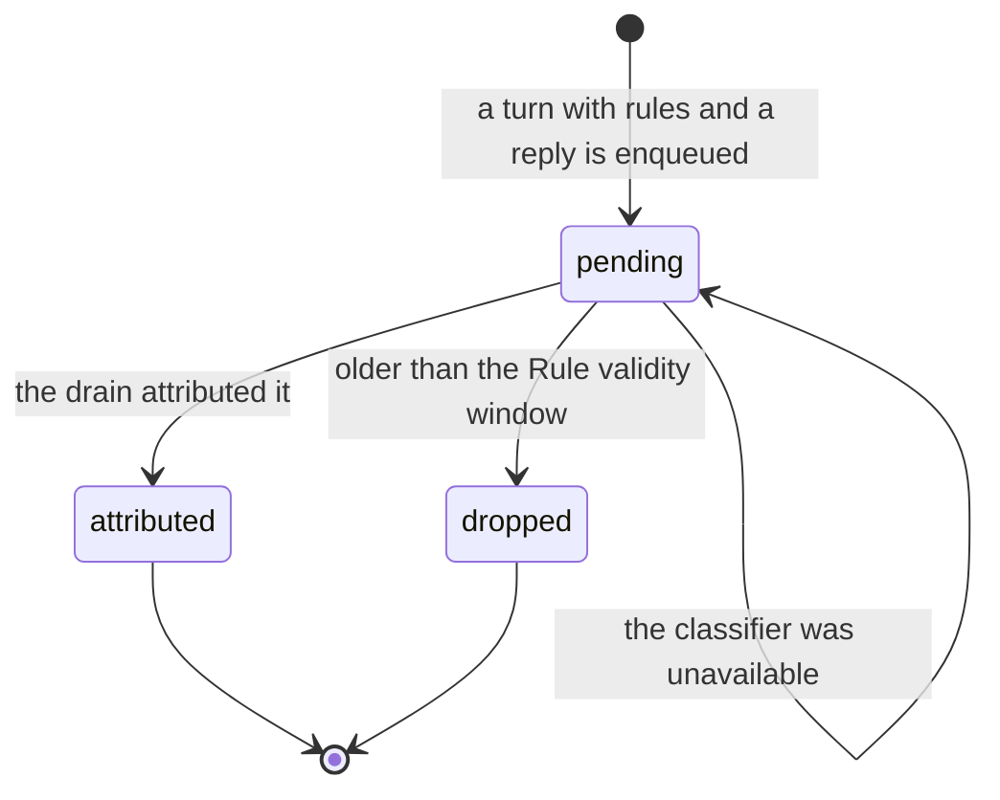

# Model: rule-system

The learned-rule system as built through #168: a turn becomes evidence about
the Rules it applied. Spec: `docs/specs/rule-system.md`; design:
`docs/design/rule-system.md`.

## Lifecycle inventory

| Entity | Moves in time? | Statechart |
|---|---|---|
| `Rule` | yes — `state` enum plus confidence-driven transitions | required, see [Rule](#rule) |
| `QueuedFeedback` | yes — `status` enum (`pending`, `attributed`, `dropped`) driven by the drain | required, see [QueuedFeedback](#queuedfeedback) |
| `RuleUse` | no — an immutable record of one application | — |
| `Feedback` | no — it exists only inside one attribution run | — |
| `SplitProposal` | no — it exists only inside one split, handed straight to the service | — |

## Elements

| ID | Kind | Code | Source |
|---|---|---|---|
| Loop | module | src.cortex.agentic.loop | `src/cortex/agentic/loop.py` |
| Bundle | entity | MemoryContext | `src/cortex/agentic/models.py:102` |
| Classifier | symbol | src.cortex.rules.feedback.FeedbackClassifier.classify | `src/cortex/rules/feedback.py` |
| Attribution | symbol | src.cortex.rules.attribution.AttributionRun.attribute | `src/cortex/rules/attribution.py` |
| Service | symbol | src.cortex.rules.service.RuleService.record_use | `src/cortex/rules/service.py:92` |
| Split | symbol | src.cortex.rules.splits.SplitProposer.propose | `src/cortex/rules/splits.py` |
| Enqueue | symbol | src.cortex.rules.queue.enqueue_turn | `src/cortex/rules/queue.py` |
| Drain | symbol | src.cortex.rules.queue.FeedbackDrain.drain | `src/cortex/rules/queue.py` |
| Render | symbol | render_rules | `src/cortex/rules/render.py:21` |
| Provider | external | https://github.com/openai/openai-python | `src/cortex/llm/providers/openai.py` |

## Flow

## Sequence

## State machines

### Rule

Slice A's machine; #168 is the first thing that drives it from a real turn.

### QueuedFeedback

A row waits, is attributed, or ages out. A failed classification keeps it
waiting: the queue exists so that a provider outage costs a delay.

## Model changes

| # | Element | Change | Why | Approval |
|---|---|---|---|---|
| 1 | `QueuedFeedback` | - | The design lists the queue; #168 delivered the classifier and the run only | https://github.com/salvatorebottiglieri/botti-agent/issues/166#issuecomment-7038922357 |
| 2 | `QueuedFeedback` | + | #169 builds the queue: the row moves pending → attributed, stays pending when the classifier is unavailable, and is dropped past the validity window | https://github.com/salvatorebottiglieri/botti-agent/issues/169 |
| 3 | `Rule` | + | #171 splits a rule through the service instead of penalising it: a scope correction archives the parent and creates two children, so the machine gains the transition that leaves a rule for a Split | https://github.com/salvatorebottiglieri/botti-agent/issues/171 |
| 4 | `QueuedFeedback` | + | #172 wires the enqueue into both chat endpoints and the drain into the composition root, so the row is written by a real turn and the pending → attributed transition happens in the running system; the rules of the row are the active set read before the turn (design Decision 4, owner's answer "A" of 2026-11-23) | https://github.com/salvatorebottiglieri/botti-agent/issues/172 |

## Notes

Since #172 the model describes the running system: both chat endpoints read the active set before the
turn and enqueue the row after the answer, and `main.py` starts the drain beside the evidence sweep.
The eval runner calls `AgentLoop.stream_chat` directly and never enqueues, so an eval still learns nothing.
