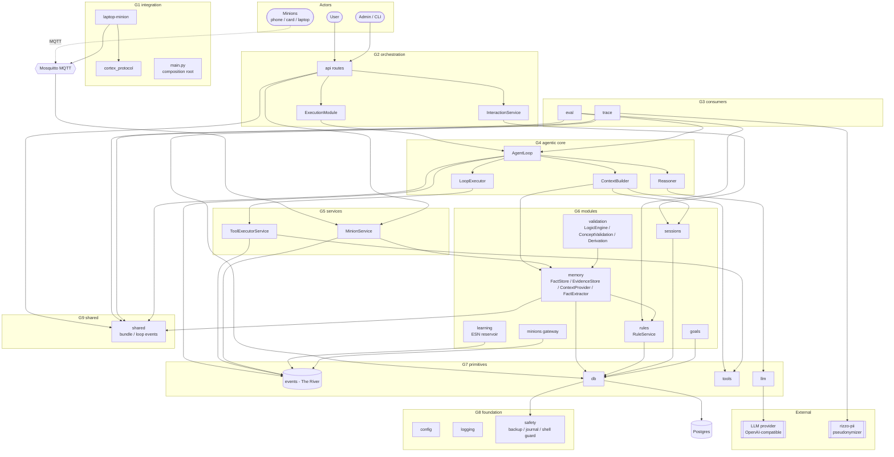
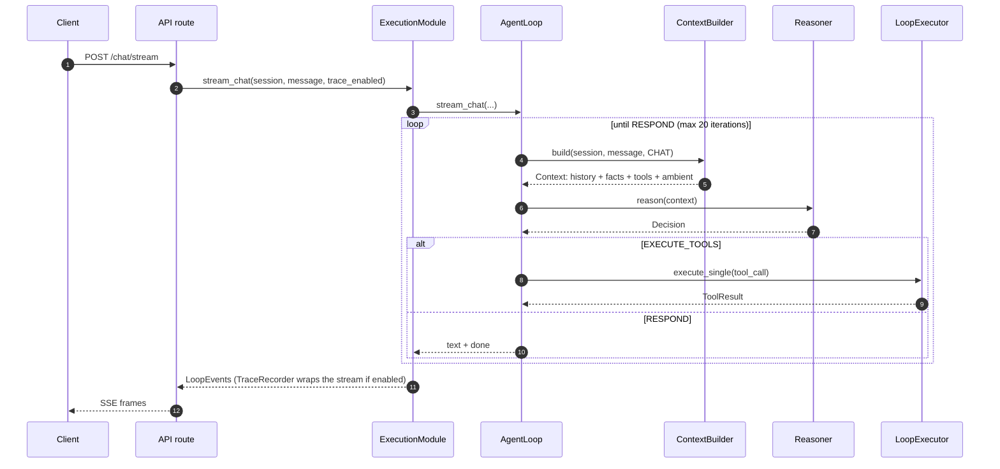
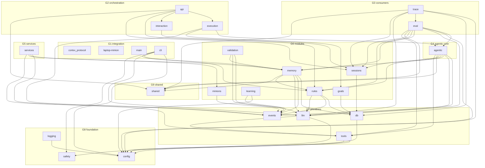

# Architecture

> **Current truth** for Cortex's module layout, event bus, persistence and deployment.
> Updated in place. Decisions (and the alternatives rejected) live in `docs/adr/`.
> Subsystems with their own spec: [agentic-loop.md](agentic-loop.md),
> [evidence-system.md](evidence-system.md), [minion-protocol.md](minion-protocol.md),
> [eval-system.md](eval-system.md), [trace-system.md](trace-system.md),
> [rule-system.md](rule-system.md), [safety-net.md](safety-net.md).

## Sources of truth

- `CONTEXT.md` — vocabulary.
- `docs/adr/` — why (decisions, rejected alternatives).
- GitHub issues — planned work, with acceptance criteria.
- This document — the system as a whole. **Keep it in sync with changes.**

## System overview

One diagram, all subsystems. Nodes are grouped by the enforced order (see the
module map below); external systems and data stores are outside the `Cortex`
groups.
Solid arrows are runtime calls; `-.` arrows are protocol/MQTT paths.

> The minion path drawn as `Edge -. MQTT .-> MQ` is **not wired end to end
> today** — see [minion-protocol.md](minion-protocol.md) § Status.
> `cortex_protocol` is the shared schema package that `laptop-minion` (and
> future phone/card minions) depend on.

Runtime at a glance — one chat turn (details in
[agentic-loop.md](agentic-loop.md), trace wrapping in
[trace-system.md](trace-system.md)):

Modules communicate by publishing and subscribing to events, not by calling each
other directly. Direct calls exist only where the composition root wires a
consumer to a producer (services, repositories).

## The River (event bus)

`src/cortex/events/`:

| Piece | Role |
|---|---|
| `EventBus` (`bus.py`) | In-memory asyncio pub/sub. Wildcard `"*"` subscriptions, per-handler error isolation, `start()`/`stop()` lifecycle. |
| `BaseEvent` / `EventMetadata` (`base.py`) | Every event carries `type`, `payload`, and metadata: `timestamp`, `source_module`, `trace_id`, `session_id`, `salience` ∈ [0,1], `correlation_id`. |
| `EventEmitter` (`emitter.py`) | Safe publish seam: never raises, tolerates a `None` bus. Every module publishes through this. |
| `EventTypes` (`types.py`) | The canonical event-name enum. |

Event types (`EventTypes`):

| Group | Names |
|---|---|
| Conversation | `user.message`, `conversation.message`, `conversation.ended` |
| Sensor | `location`, `payment`, `activity`, `calendar`, `call_log`, `app_usage` |
| Learning | `pattern.detected`, `preference.learned`, `recommendation.generated`, `recommendation.executed` |
| Tools / goals | `tool.request`, `tool.result`, `goal.created`, `goal.status`, `goal.completed`, `goal.failed`, `goal.resumed` |
| Validation | `concept.validated`, `concept.rejected` |
| Rules | `rule.promoted` (published after the rule's commit; the line the next chat turn opens with, #173) |
| Lifecycle | `module.spawn`, `module.terminate` |
| Wildcard | `*` |

> `LoopEvent` (the agent loop's progress stream) is **not** a bus event — see
> [agentic-loop.md](agentic-loop.md).

## Module map

### The enforced order

The order below is not a convention: `[tool.importlinter]` in `pyproject.toml`
holds it (ADR-0022). A module may import a group **below** it; a same-group
import is legal only if it closes no cycle (`acyclic_siblings`). Top to bottom
in the table, bottom-up in the sections that follow it:

| # | Group | Members |
|---|---|---|
| 1 | integration | `main`, `cli` |
| 2 | orchestration | `api`, `execution`, `interaction` |
| 3 | consumers | `eval`, `trace` |
| 4 | agentic core | `agentic` |
| 5 | services | `services` |
| 6 | modules | `sessions`, `memory`, `validation`, `goals`, `minions`, `rules`, `learning` |
| 7 | primitives | `events`, `llm`, `tools`, `db` |
| 8 | foundation | `config`, `logging`, `safety` |
| 9 | shared | `shared` |

The scale follows **who drives whom**, not the folder names. The one place
where this inverts the older L0–L6 numbering this document used is `eval` and
`trace`: the old table filed both under Layer 2 (standalone modules) while
`agentic` was Layer 4, and the check puts them *above* it. They belong above
because they consume the loop — the eval harness builds a real `AgentLoop`
(`eval/runner.py`) and the trace recorder consumes the `LoopEvent` stream it
emits — and a consumer below what it drives would have to be imported by it.
The diagram at the top already drew `Eval --> Loop`; the numbers said the
inverse.

### Group 9 — shared

| Piece | Path | Role |
|---|---|---|
| The bundle | `src/cortex/shared/bundle.py` | `MemoryContext` (facts, personality, ambient, rules, `degraded_dimensions`), `PersonalityContext`, `AmbientContext` — what the Memory Module contributes to a reasoning step |
| The loop's events | `src/cortex/shared/loop_events.py` | `LoopEvent` and its seven subclasses (`thinking`, `text`, `tool_start`, `tool_done`, `done`, `ask_user`, `error`); `event_type` is the wire name, `to_dict()` the JSON form |

`shared` imports nothing from `cortex` at runtime: its only `cortex` imports
are `Fact`, `Rule` and `UsageStats` under `if TYPE_CHECKING:`. A type it needs
at runtime would have to move down with it.

### Group 8 — foundation

| Component | Path | Role |
|---|---|---|
| Config | `src/cortex/config/` | YAML + env settings (Pydantic); per-module settings models |
| Logging | `src/cortex/logging/` | structlog setup, `trace_id` propagation |
| Safety | `src/cortex/safety/` | `backup.py` (PostgreSQL dumps, the external store), `journal.py` (snapshots, journal, undo), `shell_guard.py` (deny-list). See [safety-net.md](safety-net.md), ADR-0021 |

### Group 7 — primitives

| Component | Path | Role |
|---|---|---|
| Event bus | `src/cortex/events/` | The River (above) |
| LLM | `src/cortex/llm/` | Provider-agnostic `LLMClient`; `LLMClientFactory`; `CircuitBreaker` wrapper (ADR-0009) |
| Tools | `src/cortex/tools/` | `ToolRegistry` / `ToolExecutor` interfaces, `InMemoryToolRegistry`; meta tools `file_read`, `file_write`, `grep`, `shell`, `ask_user`, registered deny-by-default from the `ToolsSettings` allow-list (`TOOLS_ALLOW`) |
| DB | `src/cortex/db/` | asyncpg pool, `DbSession` context manager, migration runner |

### Group 6 — modules

| Module | Path | Public seam |
|---|---|---|
| Sessions | `src/cortex/sessions/` | `SessionRepository`; lifecycle free functions in `policy.py` (`create_session`, `resume_session`, `add_user_message`, `end_session`, `get_or_create_session`, ADR-0011) |
| Memory | `src/cortex/memory/` | `FactStore` (CRUD + dedup; records each observation through `PostgresEvidenceStore`, which owns `facts.confidence`, ADR-0013), `EvidenceStore` (synchronous in-memory E1 contract), `ContextProvider` (the bundle seam, personality/ambient; the bundle types it returns live in `shared`), `FactExtractor` (ingestion); split from `MemoryService` per ADR-0003 |
| Validation | `src/cortex/validation/` | LogicEngine (strict Datalog parser + PyDatalog), ConceptValidationService (ADR-0007) and ConceptDerivationService (LLM revision loop, `concept.validated`/`concept.rejected` events, #28/#29); `ContextProvider.store_concept` stores only validated concepts |
| Goals | `src/cortex/goals/` | `Goal`, `GoalStep`, `GoalStatus` (`models.py`), `GoalRepository`, persistent/resumable goals (ADR-0004) |
| Minions | `src/cortex/minions/` | `MinionGateway`, `MinionRegistry`, `MinionEventHandler`; `MinionMQTTClient`. See [minion-protocol.md](minion-protocol.md) |
| Rules | `src/cortex/rules/` | `RuleRepository`, `RuleService` (create / record_use / sweep / archive / split / merge), the pure score in `scoring.py`, `render_rules`; the feedback queue (`FeedbackQueue`, `enqueue_turn`, `FeedbackDrain`) and the attribution seam the chat endpoints import (`AttributionRun`, #168-#172). See [rule-system.md](rule-system.md) |
| Learning | `src/cortex/learning/` | Echo State Network (`reservoir.py`), per-target readouts, `encoding.py`, `module.py` (ADR-0001) |

### Group 5 — services

| Service | Path | Role |
|---|---|---|
| `ToolExecutorService` | `src/cortex/services/tool_executor.py` | Tool execution with circuit breaker, event emission, metrics |
| `MinionService` | `src/cortex/services/minion_service.py` | MQTT gateway → facts/events on the bus |

### Group 4 — agentic core

`src/cortex/agentic/` — `ContextBuilder`, `Reasoner`, `LoopExecutor`, `AgentLoop`, `PromotionNotices` (the `rule.promoted` buffer, #173), and in `models.py` the loop's own vocabulary: `Decision`, `DecisionType`, `Mode`, `Context`, `GoalContext`, `ChatResponse`, `GoalResult`, `MaxIterationsError`.
It no longer owns the system's shared vocabulary: the context bundle is
`shared/bundle.py` and the loop's events are `shared/loop_events.py` (#181), so
`memory`, `api`, `trace` and `eval` import those without importing the loop.
Full contract in [agentic-loop.md](agentic-loop.md).

### Group 3 — consumers

| Module | Path | Public seam |
|---|---|---|
| Eval | `src/cortex/eval/` | fixtures, runner, grader, judge, metrics, baseline, gate; the runner builds a real `AgentLoop` per task inside a sandbox. See [eval-system.md](eval-system.md) |
| Trace | `src/cortex/trace/` | `TraceRepository`, `TraceRecorder` (consumes the `LoopEvent` stream), `Pseudonymizer`, `audit`. See [trace-system.md](trace-system.md) |

### Group 2 — orchestration

| Component | Path | Role |
|---|---|---|
| `ExecutionModule` | `src/cortex/execution/module.py` | Goal lifecycle events; chat/goal entry points; wires the trace consumer around the loop |
| `InteractionService` | `src/cortex/interaction/service.py` | Thin I/O facade over session policy |
| API | `src/cortex/api/` | FastAPI app, auth, routes |

### Group 1 — integration

| Component | Path | Role |
|---|---|---|
| `cortex-protocol` | `src/cortex_protocol/` | Shared, language-agnostic minion schemas + MQTT topics; separate distributable package, outside the `cortex` package and its contracts |
| `laptop-minion` | `laptop-minion/` | Standalone laptop sensor agent (own `pyproject.toml`, tests), outside the contracts |
| Composition root | `src/cortex/main.py` | `initialize_app()` wires everything |
| CLI | `src/cortex/cli.py` | `cortex <command>`; the operator's entry points into `rules`, `memory`, `safety` |

## Dependency direction

Every arrow points down the nine groups and there is no cycle between two
modules (ADR-0022). `memory` and `agentic` both take the bundle and the loop's
events from `shared` instead of from each other, so the only edge between them
is `agentic → memory` (the loop renders the bundle). Consumers reach Memory
through the `ContextProvider` bundle seam, never through raw SQL or
`MemoryService` (the class no longer exists — ADR-0003).

## Composition root

`initialize_app()` in `src/cortex/main.py` applies migrations, then wires in order:
sessions → goals → trace → memory → rules → LLM factory → validation pipeline
(`LogicEngine` → `ConceptValidationService` → `ConceptDerivationService`) →
tool registry → `ToolExecutorService` → `ContextBuilder`/`Reasoner`/`LoopExecutor`/`AgentLoop`
→ `ExecutionModule` → `InteractionService` → optional `MinionService`. The
`ContextProvider` receives the `ConceptDerivationService` (validated concept
storage). Repositories and services are injected; the agentic core constructs
nothing itself.

## Persistence

Migrations in `migrations/` (raw SQL, applied by `src/cortex/db/migrations/runner.py`):

| Table | Holds |
|---|---|
| `sessions`, `messages` | Conversation state that feeds context building |
| `facts`, `concepts` | Memory: typed facts (payload + confidence + layer + `vector(1536)` embedding, ADR-0008) and derived concepts |
| `evidence` | Facts: one accepted observation per row (`fact_id` FK, `source_type`/`source_id`, `value_hash`, `strength`, `observed_at`); `facts.confidence` is the posterior over active evidence (ADR-0013, [evidence-system.md](evidence-system.md)) |
| `goals`, `goal_steps` | Persistent, resumable goals |
| `minions` | Registered minions, state, last heartbeat |
| `api_keys` | Admin API tokens (hashed) |
| `loop_events` | Pseudonymized runtime traces (ADR-0017) |
| `rules`, `rule_uses` | Learned rules and the ledger of their applications (ADR-0020, [rule-system.md](rule-system.md)) |

## API surface

FastAPI routes under `src/cortex/api/routes/`: `chat` (POST `/chat`, POST
`/chat/stream`), `sessions`, `goals`, `minions` (admin), `admin_auth`, `health`.
SSE wire contract for `/chat/stream` is in [agentic-loop.md](agentic-loop.md).

## Deployment

`docker-compose.yml`:

| Service | Image | Notes |
|---|---|---|
| `postgres` | `pgvector/pgvector:pg16` | Port 5432 (host: `${POSTGRES_HOST_PORT:-5433}`) |
| `mosquitto` | `eclipse-mosquitto:2` | Port 1883; broker config in `docker/mosquitto.conf` |
| `cortex` | built from `Dockerfile` | Port 8000; runs as root for now (non-root is #120); host safety store mounted at `/var/lib/cortex/safety`; depends on healthy postgres + mosquitto and the one-shot `safety-store` |
| `rizzo-pii` | pinned upstream `Rizzo-AI-Academy/rizzo-pii@v2.0.0` | Opt-in `--profile trace`; pseudonymization sidecar for trace capture |

CLI (`cortex <command>`, `src/cortex/cli.py`): `token:create`, `traces:cleanup`,
`rules:list`, `rules:show`, `rules:archive`, `memory:backfill-embeddings`,
`backup:create`, `backup:restore`, `undo`, `version`.

Backups and the safety store live at `SAFETY_STORE_DIR`
(`~/.local/share/cortex`), outside the repo and outside every Compose volume:
a backup inside the volume dies with `docker compose down -v`. The one-shot
`safety-store` service creates `backups/` and `snapshots/` and chowns the store
to the host user; each new dump is chowned to the store owner, mode `0600`.
The `cortex` container still runs as root for now — the mosquitto passwd volume
write needs it; non-root is #120's companion change. `backup:*`
prefers a host `pg_dump`/`pg_restore` and falls back to
`docker compose exec` for the local Postgres; the pre-migration dump runs
inside the Cortex image, which ships PostgreSQL 16 client tools
([safety-net.md](safety-net.md), ADR-0021). The opt-in `shell` tool checks the
#148 deny-list and journals every denial or bypass; a pattern match is refused,
an unknown command still runs — it is a mitigation, not a sandbox.

## Configuration

`Settings` is composed of per-module slices handed to consumers by constructor
injection (ADR-0010): `database`, `llm` (provider, model, base_url, timeout,
judge model, pricing, circuit breaker), `mqtt` (broker_url, keepalive, reconnect),
`app` (host, port), `trace` (sidecar URL, timeout, retention), `logging`,
`learning`, `tools` (allow-list), `safety` (store dir, backup retention,
snapshot toggle, shell-guard bypass, pre-migration policy). `config.yaml` carries
one optional section per slice. Sources rank `env > constructor arguments (config.yaml) > .env >
secrets dir` (ADR-0019), implemented by
`CortexSettings.settings_customise_sources` in `src/cortex/config/base.py`:
an exported variable beats the YAML section, the YAML section the loader passes
as a constructor argument beats `.env`, and `.env` beats the field default.

Each slice reads its own environment namespace: `DATABASE_URL`/`DB_POOL_*`,
`LLM_*` (plus the legacy `CIRCUIT_BREAKER_*` spellings), `MQTT_*`, `APP_*`,
`TRACE_*`, `LOG_*`, `LEARNING_*`, `TOOLS_*`, `SAFETY_*`. The slices are nested fields of
the root, so a bare variable named after one (`APP`, `LLM`, `TRACE`, …) is read
as that slice and surfaces as a validation error rather than being ignored.

### System invariants

| Invariant (law) | Negation → test | Verified in |
|---|---|---|
| **CFG1** — an exported environment variable beats `config.yaml` for the same field | the YAML value is returned while the same variable is exported | `tests/config/test_loader.py::TestPrecedence::test_env_beats_yaml` |
| **CFG2** — with no variable exported, `config.yaml` beats `.env` and beats the field default | `.env`, or the default, is returned while the YAML section supplies that field | `::test_yaml_beats_dotenv`, `::test_yaml_beats_default` |
| **CFG3** — a constructor argument — the loader's YAML section, or any caller's kwarg — beats `.env` but loses to the environment, at the root and inside a nested slice | a nested kwarg wins while the matching variable is exported | `tests/config/test_models.py::TestSourcePrecedence::test_env_beats_nested_constructor_kwarg` |
| **CFG4** — no ambient environment variable configures a settings object during the test run | an ambient variable shifts an assertion | `tests/conftest.py::_no_ambient_settings_env` + `tests/config/test_models.py::TestSourcePrecedence::test_exported_variable_does_not_reach_a_test` + `tests/config/test_models.py::TestAmbientEnvGuard::test_every_settings_env_name_is_scrubbed` |
| **CFG5** — a YAML `${VAR}` whose variable is unset drops that key, so the variable or the default applies | the literal placeholder reaches the model | `tests/config/test_loader.py::TestPrecedence::test_unresolved_env_ref_falls_back_to_default` |
| **CFG6** — a missing `LLM_API_KEY` raises `ValidationError` naming `api_key`, whatever the precedence | a settings object is built without the secret | `tests/config/test_loader.py::TestSectionMapping::test_missing_api_key_still_fails_loudly`, `tests/config/test_models.py::TestMissingSecretFailsLoudly` |

The env-fallback sibling (`::test_unresolved_env_ref_falls_back_to_env_var`) is
not coverage for CFG5: under a precedence where the environment outranks
constructor arguments, a retained `${VAR}` placeholder would still be beaten by
the exported `LLM_BASE_URL`, so that test passes either way. Only the
default-fallback case, which deletes the variable, is failing-capable for the
placeholder drop.

## Testing and CI

`tests/` mirrors `src/` plus `tests/eval/` (the eval suites) and `tests/integration/`.
CI: `.github/workflows/ci.yml` (lint + unit + boundaries),
`.github/workflows/eval.yml` (eval gate, see [eval-system.md](eval-system.md)).

### Module boundaries

`[tool.importlinter]` in `pyproject.toml` is the fitness function for the
module map above (ADR-0022, issue #167):

- a `layers` contract over the nine groups, in the order of the table;
- an `acyclic_siblings` contract over the same groups, so a same-group import
  is legal only while it closes no cycle;
- `exclude_type_checking_imports = true`, set once under `[tool.importlinter]`
  as a session option, so a `TYPE_CHECKING` alias is not a runtime edge;
- **zero `ignore_imports`.** An exception list would turn design debt into a
  passing check; `tests/unit/test_module_boundaries.py` asserts neither
  whole-map contract grows one.

The `Boundaries` job in `.github/workflows/ci.yml` runs `uv run lint-imports`:
four contracts kept (the two whole-map ones plus the two `protected` ones that
keep `cortex.rules.repository` and `cortex.rules.scoring` private to `rules`),
none broken. An upward runtime import or a two-module cycle fails the job; the
pair of documents moves together — `pyproject.toml` and this file.
