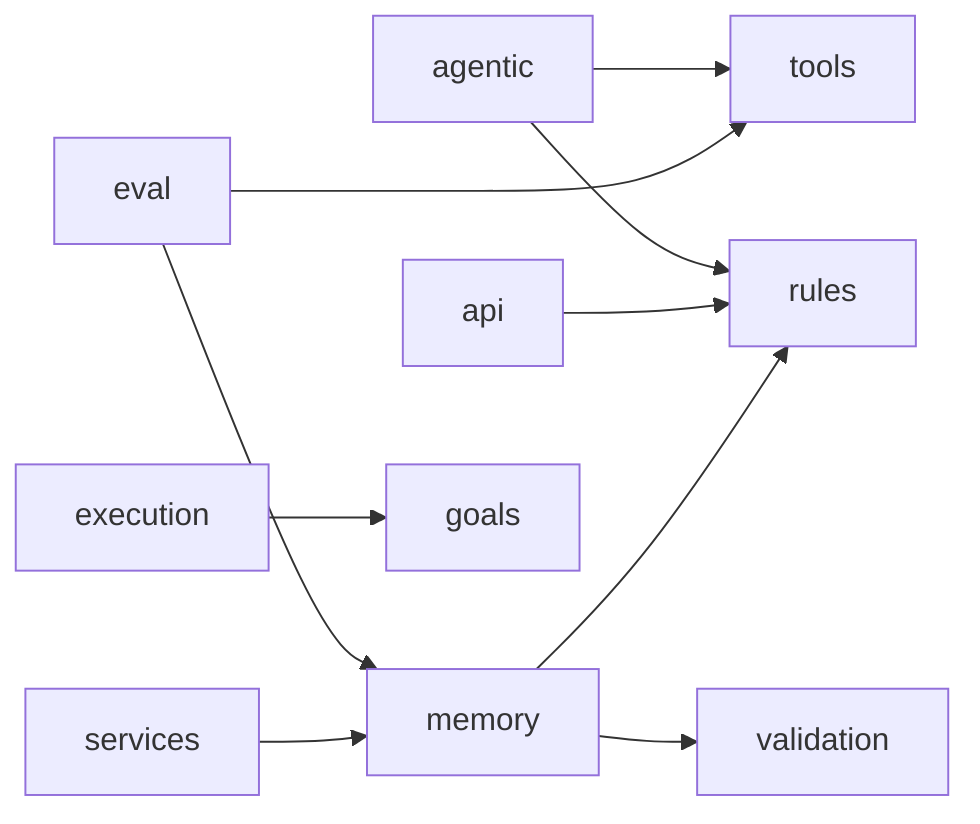

# Module API — one front door per module, and a contract that keeps it

## Phase plan

| Phase | Decision | Reason |
|---|---|---|
| 1 · Design & alignment | run | the four choices (where the door lives, what stays open, which modules, the one awkward construction) were decided with the owner in chat, and their blast radius has to be measured |
| 2 · Product review | skip | nothing reaches a user: re-exports, imports and one group of CI contracts; no UI surface |
| 3 · System architecture | run | this feature *is* the module map's second half: a new contract family and a declared surface per module, which the next module inherits |
| 4 · Tickets | run | — |
| 5 · Program design | run | — |
| 6 · Implement-loop | run | — |

Approved: 2026-11-24, owner in chat — "Mi torna il tuo consiglio, per quella roba la risolviamo con un ticket a valle"

## Problem Statement

ADR-0022 made the module map checkable in one direction only: a module may import a group below it, and no two modules may form a cycle. It says nothing about *which file* of the module it may import, so every module is entered through whatever file happens to hold the class.

The cost is measured, not hypothetical (P2): ten runtime imports cross a module boundary through a submodule that is not the module's declared surface. `ExecutionModule` even constructs another module's implementation on its own (`execution/module.py:62`, `InMemoryGoalRepository`) instead of requiring it, which is the same shortcut the composition root exists to prevent. Renaming a method on `FactStore` or `ContextProvider` breaks `services` and `eval` at review time, and no job in CI sees it: the two `protected` contracts in `pyproject.toml` protect `cortex.rules.repository` and `cortex.rules.scoring`, and nothing else.

The awkward part is that the doors mostly exist (P3): `memory`, `trace` and `tools` already re-export their public names in `__init__.py`, and nothing uses them (P4). Only `rules` explicitly tells readers to import submodules, and `goals` has no door at all.

## Solution

Each module names one public surface, and a contract per module makes everything else private to it.

- **The door is the package `__init__`.** `from cortex.memory import ContextProvider` — the file that already exists in three of the five modules, completed where it is missing (`rules`, `goals`). No new layer, no new file per module: importing a submodule executes the parent `__init__` anyway (P5), so the door costs no extra import.
- **`models` and `interfaces` stay open.** They are the vocabulary modules share, not an implementation; hiding them would force the door to re-export every dataclass.
- **The composition root may import anything.** `main` and `cli` construct concrete objects on purpose; that is their job.
- **One `protected` contract per module**, in the shape the rules module already uses: `protected_modules` lists the implementation submodules, `allowed_importers` names the module itself, `cortex.main` and `cortex.cli`. `import-linter` accepts several entries per contract (P7).
- **The ten sites move to the doors**, and the one construction shortcut goes: `ExecutionModule` requires a goal repository, and the single test that relied on the default passes an in-memory one (P6).

Scope: `memory`, `rules`, `tools`, `goals`, `trace`. The first four carry violations today; `trace` has none at runtime (P2) and joins the family so it stays that way. `sessions` and `minions` are already clean and are not touched.

## User Stories

1. As a module author, I want one file that says what my module offers, so that I can change its internals without reading every caller.
2. As a reviewer, I want CI to reject an import that reaches into another module's implementation, so that the door is a rule and not a habit.
3. As a reviewer, I want the exception list of every module contract to be empty, so that a green check means nobody bought an exception.
4. As a maintainer of `memory`, I want `from cortex.memory import ContextProvider, FactStore` to work, so that the two names a consumer needs are the ones my package exports.
5. As a maintainer of `rules`, I want the module to stop telling readers to import submodules, so that its docstring and its surface agree.
6. As a maintainer of `goals`, I want a package `__init__` that exports the repository interface and its implementations, so that `ExecutionModule` stops reaching into `goals.repository`.
7. As a maintainer of `tools`, I want the four internal submodules protected while the meta tools and the interfaces stay reachable through the package, so that the registry and the executor can change shape.
8. As the author of the composition root, I want to keep importing concrete classes from anywhere, so that wiring stays in one place.
9. As a maintainer of `eval`, I want the harness to build the loop through the modules' doors, so that an internal rename shows up as a contract failure and not as a broken eval run.
10. As the owner of the architecture document, I want the module map to describe both halves — the order and the door — so that the next module is placed and surfaced by the same document.
11. As a test author, I want tests to keep importing submodules directly, so that contract fakes can sit at the seam they replace.
12. As the next person to add a module, I want a copy-paste contract and a door to imitate, so that a new module is born private.

## Premises

Measured 2026-11-24 on `develop` `14fe0d4` by this session; independently re-checked, read-only, by a scout in a fresh context (see the verdict column for the scout's corrections).

| # | Premise | Command | Output | Verdict |
|---|---|---|---|---|
| P1 | CI enforces four contracts: `layers`, `acyclic_siblings` and two `protected`, both for `rules`; no other module's internals are protected, and no contract carries `ignore_imports` | `sed -n '/\[tool.importlinter\]/,$p' pyproject.toml` | `protected_modules` = `cortex.rules.repository`, `cortex.rules.scoring`; `ignore_imports` appears only in a comment | confirmed |
| P2 | Ten runtime imports in `src/` cross into a submodule of `memory`, `rules`, `tools`, `goals` or `trace` that is not `interfaces`/`models`; `trace`, `sessions` and `minions` have none there. Repo-wide the count is not ten: `tests/` adds 76 | AST scan over `src/cortex/**/*.py` and `tests/**/*.py`, skipping `if TYPE_CHECKING:` and counting function-local imports | `agentic/loop.py:31` `tools.meta`; `agentic/reasoner.py:14` `rules.render`; `api/routes/chat.py:21` `rules.queue`; `eval/runner.py:39` `tools.executor`; `eval/runner.py:40` `tools.registry`; `eval/runner.py:361` `memory.context_provider`; `eval/sandbox.py:22` `tools.meta`; `execution/module.py:62` `goals.repository`; `services/minion_service.py:9` `memory.fact_extractor`; `services/minion_service.py:10` `memory.fact_store`. The same scan over `tests/` finds 76 more (`tests/unit/rules/test_service.py:32`, `tests/memory/test_fact_store.py:8`, `tests/unit/trace/test_recorder.py:37`, `tests/unit/goals/test_resume.py:23`, `tests/unit/test_tools_meta.py:10`, ...) | confirmed for `src/`; falsified as a repo-wide count |
| P3 | Three of the five already declare a public surface in `__init__.py`; `rules` tells readers to import submodules; `goals` has none | `cat src/cortex/{memory,trace,tools,rules,goals}/__init__.py` | `memory`: `ContextProvider`, `FactStore` + models; `trace`: `TraceRepository`, `TraceEvent`, `PostgresTraceRepository`; `tools`: 30 names; `rules`: docstring "Import the submodules (`cortex.rules.service`, ...)"; `goals`: one docstring line | confirmed |
| P4 | No cross-module code imports a package-level name today: the doors that exist are unused | `grep -rn "^from cortex\.\(memory\|rules\|tools\|goals\|trace\) import" src/ tests/` | two hits, both submodules: `cortex.trace import audit`, `cortex.rules import queue` | confirmed |
| P5 | Using the door costs no extra import edge: a submodule import executes the parent `__init__.py` regardless | `uv run python -c "import sys, cortex.memory.context_provider; print('cortex.memory' in sys.modules)"` | `True`; the scout adds that the parent's own re-exports are a *hard* import at that point (`import cortex.memory.models` already loads `fact_store`, `evidence_store`, `db`, `asyncpg`), so a new re-export can create an upward edge or a cycle | confirmed, with a design consequence |
| P6 | `ExecutionModule` constructs `cortex.goals.repository.InMemoryGoalRepository` when no repository is injected, and several tests rely on that fallback | `grep -rn "[^e]ExecutionModule(" tests/ src/` | `execution/module.py:68` `goal_repository or InMemoryGoalRepository()`; callers relying on it: `tests/unit/api/test_chat_stream.py:717` and `tests/unit/execution/test_module.py:396,423,453`; `src/cortex/main.py:355` injects the Postgres repository | confirmed |
| P7 | `import-linter`'s `protected` accepts several `protected_modules` and module expressions in `allowed_importers` | `uv run python -c "import inspect, importlinter.contracts.protected as p; print(...)"` | `protected_modules = fields.ListField(subfield=fields.ModuleExpressionField())`, same for `allowed_importers` | confirmed |

## Model

Model skipped — the feature adds no flow and no state: it declares each module's public surface and checks the imports that cross it, so no entity changes state over time.

## Implementation Decisions

- The public surface of a module is its package `__init__.py`; `interfaces` and `models` remain importable directly.
- `allowed_importers` for every module contract: the module itself, `cortex.main`, `cortex.cli`.
- `tests/` sits outside the contract's `root_package`, so tests keep importing whatever seam they fake.
- `goals.__init__` exports the repository interface and its implementations; `rules.__init__` exports `RuleService`, `render` and `enqueue_turn`, replacing the docstring that points at submodules.
- `ExecutionModule.__init__` takes `goal_repository` as a required argument; the callers that leaned on the default inject one explicitly.
- A door re-exports only the names consumers need, and never a name whose import would pull an upper group into the package `__init__`: the package body runs on every submodule import (P5), so a careless re-export turns a legal submodule import into an upward edge.

## Testing Decisions

- The contracts are the tests for the boundaries: each is proven red by a control violation before it is kept, the recipe ADR-0022 used.
- `tests/unit/test_module_boundaries.py` grows to assert the per-module contracts exist with empty `ignore_imports`, next to the existing whole-map assertions.
- Removing the `ExecutionModule` default gets a test that the constructor no longer fabricates a repository; the callers in `tests/unit/execution/test_module.py` and `tests/unit/api/test_chat_stream.py` pass an in-memory one.
- The 76 test imports into internals stay: `tests/` sits outside the contracts' `root_package`, and a test faking a seam is the point of a seam.

## Out of Scope

- `services`, `api`, `execution`, `interaction` and `agentic` have no ports today; giving them interfaces is a later feature.
- The two wiring defects found in the study session — `state["minion_service"]` and the shutdown path — are a separate ticket (owner, in chat: "per quella roba la risolviamo con un ticket a valle").
- `sessions` and `minions` are already clean; they get no contract in this feature.
- Routing the 76 test imports through the doors: not in this feature. They are legal (outside `root_package`) and they fake the seam they replace.

## Further Notes

The doors that exist are unused, which is the strongest argument for a check rather than a convention: `memory/__init__.py` has exported `ContextProvider` and `FactStore` since the module was written, and the ten sites never noticed.

## System Architecture

### Module map

The five modules this feature surfaces, with the interface each one publishes. `+` marks what this feature adds, `~` what it changes, `-` what it removes.

| Module | Bounded context (`CONTEXT.md`) | Published interface | Owns (stored data) | Depends on | Publishes events |
|---|---|---|---|---|---|
| memory | Memory — `Fact`, `Confidence`, `Evidence` | `~` `cortex.memory`: `ContextProvider`, `FactStore` + `interfaces`, `models` | `facts`, `concepts`, `evidence` | `rules` (rules it renders into the bundle), `validation` (concept derivation) | `concept.validated`, `concept.rejected` |
| rules | Learned rules — `Rule` | `+` `cortex.rules`: `RuleService`, `render`, `enqueue_turn` + `interfaces`, `models` (the docstring "import the submodules" goes) | `rules`, `rule_uses`, `queued_feedback` | `db`, `events`, `llm` | `rule.promoted` |
| tools | Tools — `Tool`, `ToolRegistry`, `ToolExecutor` | `~` `cortex.tools` unchanged, plus `ASK_USER_TOOL_NAME` | — | `config`, `safety` | — |
| goals | Goals — `Goal` | `+` `cortex.goals`: `GoalRepository`, `PostgresGoalRepository`, `InMemoryGoalRepository` + `models` | `goals`, `goal_steps` | `db` | `goal.created` (consumed, not published here) |
| trace | Loop trace — `TraceEvent` | `cortex.trace` unchanged: `TraceRepository`, `TraceEvent`, `PostgresTraceRepository` | `loop_events` | `db`, `llm`, ripple sidecar | — |

Edges this feature touches, as a diff on the existing map (`architecture.md` § module map): no edge is added or removed at module level; every changed edge keeps its direction and only changes *which file* it lands on.

| Consumer | Was | Becomes | Edge direction |
|---|---|---|---|
| `agentic` | `cortex.tools.meta`, `cortex.rules.render` | `cortex.tools`, `cortex.rules` | down |
| `api` | `cortex.rules.queue` | `cortex.rules` | down |
| `eval` | `cortex.tools.executor`, `cortex.tools.registry`, `cortex.tools.meta`, `cortex.memory.context_provider` | `cortex.tools`, `cortex.memory` | down |
| `execution` | `cortex.goals.repository` (constructing it itself) | `cortex.goals`, injected | down |
| `services` | `cortex.memory.fact_extractor`, `cortex.memory.fact_store` | `cortex.memory` | down |

The graph stays acyclic: every arrow points at a module that already sat below the caller, and `goals` loses its only upward use (a class the caller constructed).

### System invariants

The seven laws of the module map (one row each), then the two laws this feature adds. `[prompt — no mechanical check]` marks a law whose check is a review step, with the document the reviewer reads named in the same cell.

| Invariant (law) | Negation → test | Verified in |
|---|---|---|
| **Law 1** — every module is one bounded context, named by a `CONTEXT.md` term | a module name that needs "and", or a `CONTEXT.md` entry with no module | `[prompt — no mechanical check]` `docs/specs/architecture.md` § module map |
| **Law 2** — another module reaches a module only through its published interface | `uv run lint-imports` names a `protected` contract red; e.g. `services/minion_service.py` imports `cortex.memory.fact_store` again | `pyproject.toml` (one `protected` contract per module) · `tests/unit/test_module_boundaries.py::test_every_module_contract_protects_its_implementation` |
| **Law 3** — each stored table belongs to one module, which alone reads and writes it | a table read by a second module without the owner's interface; the `## Persistence` table naming one owner per table | `[prompt — no mechanical check]` `docs/specs/architecture.md` § Persistence |
| **Law 4** — the module dependency graph is acyclic | `uv run lint-imports` `acyclic_siblings` red on a two-module cycle | `pyproject.toml` `acyclic_siblings` · `.github/workflows/ci.yml` `Boundaries` job |
| **Law 5** — a call when the answer is needed, an event when others only react | a `LoopEvent` published on the bus, or a system event turned into a return value | `[prompt — no mechanical check]` `CONTEXT.md` (`LoopEvent` vs `System Event`) |
| **Law 6** — `shared/` holds technical vocabulary only and imports no module | `cortex.shared` importing `cortex.memory`, `cortex.rules` or any other module at runtime | `pyproject.toml` `forbidden` contract for `cortex.shared` · `tests/unit/test_module_boundaries.py::test_the_shared_kernel_imports_no_module` |
| **Law 7** — a module's tests exercise it through its published interface | a test importing a protected submodule; today 76 do, and they stay legal because `tests/` sits outside `root_package` | `[prompt — no mechanical check]` `REVIEW-CRITERIA.md` (Spec axis), deferred by `## Out of Scope` |
| **A door must not import upward** — a re-export in `__init__.py` adds a hard import on every submodule import | `import cortex.memory.models` pulling an upper group: `uv run lint-imports` `layers` red on the package edge | `pyproject.toml` `layers` contract · `.github/workflows/ci.yml` `Boundaries` job |
| **No module constructs another module's implementation** — wiring belongs to the composition root | `ExecutionModule(agent_loop=loop)` succeeding without a goal repository, or `from cortex.goals.repository import` reappearing in `execution/module.py` | `tests/unit/execution/test_module.py::test_the_goal_repository_is_required` |

### Architecture notes

- **No endpoint contract and no data model**: the feature adds no route and no table; every contract it introduces is an import edge.
- **`as_packages` matters.** `import-linter`'s `protected` treats the listed module as a package (`as_packages` defaults to true, confirmed by the scout), so protecting `cortex.tools.meta` also protects its children — which is what "the implementation submodule" means.
- **One contract per module, never one shared contract.** `protected_modules = ["cortex.*.service"]` with `allowed_importers = ["cortex.*"]` would let every module into every other's internals, because each importer matches the wildcard (ENFORCEMENT.md, Python notes).
- **Law 6's contract is new and today green**: `cortex.shared` imports `Fact`, `Rule` and `UsageStats` only under `if TYPE_CHECKING:`, and `exclude_type_checking_imports = true` already ignores those.
- **The control violation recipe stays the one ADR-0022 used**: each new contract is proven red on a scratch import before it is kept, then the scratch import is discarded.

## Tickets

A linear chain: the door first, then the callers, then the contract that makes the door a rule, then the document. Work the frontier — one ticket at a time, fresh context each.

- #189 — Doors: every module publishes its surface (no blockers)
- #190 — Consumers enter through the doors, and the module stops wiring itself (blocked by #189)
- #191 — The door becomes a contract: one protected contract per module, one forbidden for the shared kernel (blocked by #190)
- #192 — The architecture document and an ADR record the published interface (blocked by #191)

## Delivery

- #189 — PR: https://github.com/salvatorebottiglieri/botti-agent/pull/193 · Model: n/a — the feature adds no flow and no state (## Model: skipped) · Mutation: module-api-mutation-r2
- #190 — PR: https://github.com/salvatorebottiglieri/botti-agent/pull/194 · Model: n/a — the feature adds no flow and no state (## Model: skipped) · Mutation: module-api-190-mutation-r4
