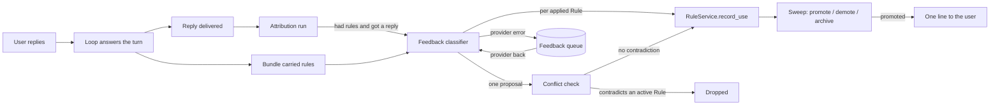
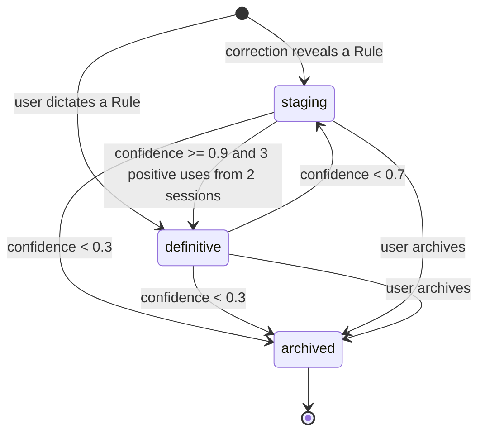
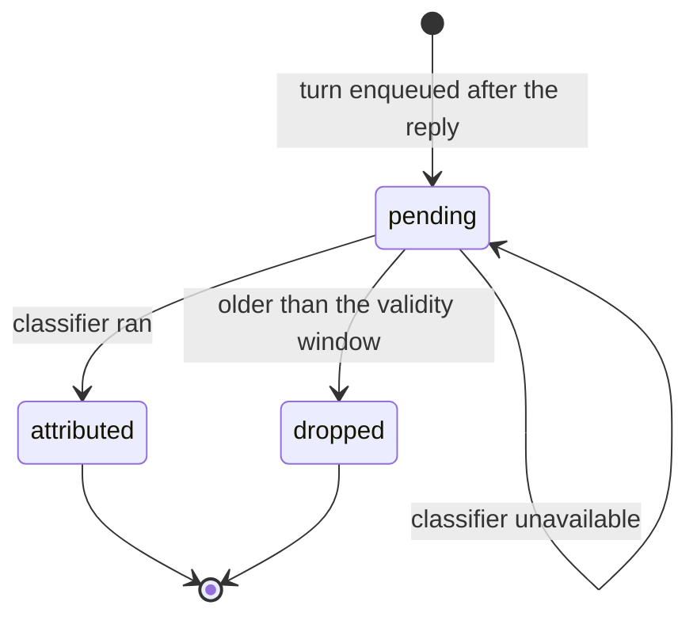

# Rule System

> Single source of truth for the learned-rule system.
> **Update this document whenever the rule system changes.**
> Rationale: `docs/adr/0020-learned-rules.md`. Vocabulary: `CONTEXT.md` (`## Rules`).
> Work items: issue #130 (slice A, closed), #166 (slice B).
>
> **Status: slice A implemented, slice B in progress (tickets #168-#172 delivered).**
> `migrations/008_rules.sql` holds the `rules` and `rule_uses` tables and
> `migrations/011_queued_feedback.sql` the queue; `src/cortex/rules/` holds the
> pure score, the repository, the lifecycle service, the prompt rendering, the
> feedback classifier, the attribution run and the durable queue. Rules are the
> fourth dimension of the context bundle, and `cortex rules:list` / `rules:show`
> / `rules:archive` manage them. Since #172 the set changes from real turns: both
> chat endpoints read the active set before the turn and enqueue one
> `queued_feedback` row after the answer, and the composition root starts the
> drain beside the evidence sweep, so `AttributionRun` scores the rules a turn
> applied. There is no CLI chat turn, so the CLI inserts nothing. The eval runner
> calls the loop directly and never enqueues. Since #173 a promotion announces
> itself: `RuleService` publishes `rule.promoted` after the refresh commits, a
> bounded buffer in `cortex.agentic.notices` holds the line, and the next chat
> turn opens with it (fixed copy, never the model's, never in the session
> history). Since #174 a dictated Rule that supersedes a known one replaces it:
> the classifier names the rule in `replaces`, the service archives the
> predecessor and links the edge. Remaining: the eval Rule set (#175).

## Phase plan

| Phase | Decision | Reason |
|---|---|---|
| 1 · Design & alignment | run | slice A shipped without the harness, so the premises below have never been checked with a command and the classifier's own contract (what "applied" means, when a turn proposes a rule) is a decision, not a text to transcribe |
| 2 · Product review | skip | nothing new is shown to the user: the classifier is invisible, and rules already surface through `cortex rules:*` and the chat |
| 3 · System architecture | run | the attribution runner adds an asynchronous seam after the turn and a feedback queue that must survive a process restart, so the component and the storage boundary are settled before the shapes |
| 4 · Tickets | run | — |
| 5 · Program design | run | — |
| 6 · Implement-loop | run | — |

Approved: 2026-11-20, owner in chat — "Ok" (to the plan as written: phases 1, 3, 4, 5, 6 run, phase 2 skip because the classifier is invisible and rules already surface through `cortex rules:*` and the chat; phase 3 kept because the runner's queue is a new stored thing).

## Premises

Measured on 2026-11-20 against `develop` (af1c42e is the last merge on `master`; `develop` carries 61 commits more) by a read-only scout; each row is a claim the slice-B design depends on.

| # | Premise | Command | Output | Verdict |
|---|---|---|---|---|
| P1 | Nothing writes a `rule_uses` row at runtime: `RuleService.record_use` has no caller outside the service and the tests | `rg -n "record_use" src tests` | `src/cortex/rules/service.py:92` (the definition) is the only hit under `src/`; every other hit is `tests/unit/rules/test_service.py` or prose in `docs/` | Confirmed |
| P2 | `create_for_module` exists but is never called from `src/`; `main.py` builds one client with `create()` | `rg -n "create_for_module" src` | `src/cortex/llm/factory.py:56` (definition) and two error strings in `wrapper.py:117,119`; `main.py:212` calls `llm_factory.create()` | Confirmed |
| P3 | The provider normalises out-of-band reasoning into an inline `<think>` block only on the streaming path; `chat()` drops it | `rg -n "reasoning" src/cortex/llm/providers/openai.py` | hits at 23–32 (`_reasoning_delta`) and 246–254 (the stream loop, `content_parts.append("<think>")`); none inside `chat()` (105–177), which builds `content=message.content` | Confirmed |
| P4 | The Learning module is an Echo State Network with no LLM client and is not mounted in the composition root, so the classifier cannot extend it | `rg -n "LLM\|llm" src/cortex/learning/` and `rg -n "LearningModule" src` | no match in `src/cortex/learning/`; `LearningModule` appears in `src/` only as a docstring mention in `config/learning.py:15`, never instantiated | Confirmed |
| P5 | There is no general job/queue mechanism in the codebase: every `create_task` is a one-off | `rg -n "asyncio.Queue" src/cortex` and `rg -n "create_task" src/cortex --type py` | no `Queue`/`scheduler`/`enqueue` match; `create_task` at `minions/mqtt_client.py:70`, `execution/module.py:404`, `main.py:364` — three one-off loops, none reusable | Confirmed |
| P6 | The agentic loop has no post-turn hook: no callback parameter, no event a runner could subscribe to after a turn | `rg -n "on_turn\|after_turn\|hook" src/cortex/agentic src/cortex/execution --type py` and the public surface of `AgentLoop` | no match for a turn hook (only `task.add_done_callback` at `execution/module.py:406`); `AgentLoop` exposes `run_chat` (`loop.py:80`), `stream_chat` (`:140`), `run_goal` (`:444`), none taking a callback | Confirmed |
| P7 | No outbox/queue table exists in the migrations to reuse for a feedback queue | `ls migrations` and `rg -n "CREATE TABLE" migrations` | ten migrations, tables: `schema_migrations`, `sessions`, `messages`, `facts`, `concepts`, `api_keys`, `minions`, `goals`, `goal_steps`, `loop_events`, `rules`, `rule_uses`, `evidence` — no outbox/jobs/queue table | Confirmed |
| P8 | `EvalTask` carries no rules, and the eval runner injects an empty context bundle | `rg -n "class EvalTask" -A30 src/cortex/eval/fixtures.py` and `rg -n "rules" src/cortex/eval` | fields are `name`, `turns`, `goal`, `description`, `sandbox`; no `rules` match anywhere in `src/cortex/eval`; `runner.py:164` returns a bare `MemoryContext()` | Confirmed |
| P9 | Rules are already the fourth dimension of the context bundle, so the runner can read the rules a turn had in context | `rg -n "rules" src/cortex/memory/context_provider.py src/cortex/agentic/models.py` | `agentic/models.py:112: rules: list[Rule]`, populated at `context_provider.py:94: bundle.rules = await self.get_rules_context()` with per-dimension degradation at `:96` | Confirmed — with a correction: the bundle type is `MemoryContext` in `src/cortex/agentic/models.py`, not in `src/cortex/memory/models.py` |
| P10 | `render_rules` injects the rule set into the system prompt, and a staged rule carries a `[provisional]` marker plus a declaration instruction | `rg -n "render_rules" src` | `agentic/reasoner.py:182: rules_text = render_rules(context.memory.rules)`; `render.py:36: line += " [provisional]"`, `render.py:39-40` appends the declaration instruction | Confirmed |

## Problem Statement

The rule system is inert. It can create a Rule, score it, promote it, split it and archive it, but nothing in the running system ever records that a Rule was applied, so a Rule's confidence never moves (P1: `RuleService.record_use` has no caller under `src/`, only the tests).

What the owner experiences as a result:

- Every correction he gives — "d'ora in poi chiedi conferma prima di prenotare" — becomes a Rule and is then forgotten. Nothing he does afterwards changes it.
- A provisional Rule stays provisional forever: promotion needs uses, and uses are never written. The assistant keeps declaring the same hypothesis in every response, and the declaration stops meaning anything.
- A Rule that was followed and rejected keeps its confidence, because a correction is an outcome and no outcome is recorded. Conversely a Rule that is right every day never consolidates.
- A Rule that is too broad keeps being applied to the situations it gets wrong, because a scope correction is what triggers a Split and nothing ever observes one.
- The Rule set only changes through the CLI, so the assistant's behaviour changes only when the owner hand-edits it — which is the thing the Rule system exists to avoid.

Second problem, structural: even a written classifier would have nowhere to run. The loop has no post-turn hook (P6: `AgentLoop` exposes `run_chat`, `stream_chat`, `run_goal`, none taking a callback) and the codebase has no queue and no outbox table (P5, P7: every `create_task` is a one-off; the ten migrations hold no job table). Feedback that cannot be written must not be lost, and today there is nothing to put it in.

## Solution

- **A feedback classifier** — one LLM call per attributed turn. It receives the Rules that turn had in context, the assistant turn as the model produced it (reasoning included, P3, P10) and the user's next message, and returns: for each Rule that was actually applied, one outcome category — approval, implicit, correction, scope correction or neutral, never a number — plus at most one proposal for a Rule the turn reveals. A Rule present in context but not applied gets no entry; an id the model invents is dropped; malformed output raises, so the caller can queue instead of losing it.
- **An attribution run after the turn.** It attaches at the *caller* of the loop — the chat endpoint, the CLI — never inside it: the answer is produced first, attribution follows, and a slow or failed classifier never delays or breaks a response. The run reads the Rules from the turn's own context bundle (P9), so it can only attribute to Rules the model could see.
- **A feedback queue.** A new table (migration 011) holds the turns waiting for attribution, with their bundle, the turn and the reply. It is drained when the classifier is available again; a provider outage or a restart postpones attribution, it does not erase it. A queued turn that is never attributable is dropped after the Rule validity window, because a use older than the window would contribute nothing anyway.
- **Proposals.** A dictation ("from now on…") becomes a dictated Rule, born definitive; a correction that no existing Rule covers becomes a correction-born Rule, born in staging. Both pass the conflict check against the active set before they are stored, and both go through `RuleService`, so the CLI and the classifier create Rules the same way.
- **The user sees the effect, not the machinery**: a provisional Rule either consolidates and stops declaring itself, or fades back to staging where he can correct it again. One line tells him when a Rule is promoted. There is no new UI; `cortex rules:list` / `rules:show` keep showing the same thing, now with uses that move.

## User Stories

1. As the owner, I want a correction I give in chat to become a Rule that is then scored by what happens next, so that the assistant stops repeating a mistake I already corrected.
2. As the owner, I want a Rule the assistant applied and I accepted to gain confidence, so that it can stop being provisional without me approving it explicitly.
3. As the owner, I want a Rule I explicitly approved to gain confidence faster than one I merely did not object to, so that my explicit answers weigh more than my silence.
4. As the owner, I want a Rule I corrected to lose confidence, so that a stale Rule stops being applied.
5. As the owner, I want a Rule that is right in general but wrong in this situation to be split instead of penalised, so that correcting an over-broad Rule does not throw away the part that works.
6. As the owner, I want silence to never count as approval, so that a Rule is not promoted just because I said nothing about it.
7. As the owner, I want a Rule that was in context but never applied to score nothing, so that merely being available does not inflate a Rule.
8. As the owner, I want the assistant's own reasoning to be read when attributing a Rule, so that attribution is based on why it acted and not only on what it wrote.
9. As the owner, I want attribution to work with a provider that publishes no reasoning, so that the feature does not depend on one provider's capability.
10. As the owner, I want a Rule I dictate ("d'ora in poi…") to be created authoritative and in force immediately, so that my explicit instruction is not treated as a hypothesis.
11. As the owner, I want a correction that no existing Rule covers to propose a new provisional Rule, so that the set grows from my corrections instead of me writing Rules by hand.
12. As the owner, I want a proposed Rule that contradicts an active one to be refused before it is stored, so that two Rules can never tell the assistant to do opposite things.
13. As the owner, I want one line when a Rule is promoted, so that consolidation is visible without digging into the CLI.
14. As the owner, I want the answer to arrive before any attribution happens, so that learning never slows a response down.
15. As the owner, I want feedback to survive a provider outage, so that a turn I gave feedback in is not silently unlearned.
16. As the owner, I want queued feedback to survive a restart, so that closing Cortex does not throw away what I just said.
17. As the owner, I want a turn that is never attributable to be dropped once it is older than the Rule validity window, so that the queue does not grow forever with feedback that could no longer score anything.
18. As the owner, I want my explicit commands to win over the classifier, so that archiving a Rule is not undone by an inferred approval.
19. As the owner, I want `cortex rules:show` to show the uses that were attributed, so that I can see why a Rule's confidence is what it is.
20. As the owner, I want no Rule to be created and no use recorded while an eval runs, so that measurements never mutate what they measure.
21. As the owner, I want an eval task to be able to carry a Rule set, so that I can measure behaviour with Rules and compare it with behaviour without them.
22. As the owner, I want a classifier that returns an unusable answer to change nothing, so that a bad model output cannot invent a use, a Rule or a promotion.

## Implementation Decisions

- **Module.** The classifier is a new module `cortex.rules.feedback`; it is not an extension of `cortex.learning`, which is an Echo State Network with no LLM client and is not mounted in the composition root (P4).
- **The seam.** The classifier receives an `LLMClient`; the composition root passes `LLMClientFactory.create_for_module("rules")`, the first use of that seam anywhere in `src/` (P2), so a classifier outage opens its own circuit and leaves the rest of Cortex alone.
- **The contract of a run.** Inputs: the turn's Rules, the assistant turn, the user's next message. Output: a `Feedback` — the attributed uses (Rule id + category) and at most one proposal (a `RuleSpec` plus its origin). No numbers, no free text, no rule text invented for an existing Rule.
- **Where a run attaches.** At the caller of the loop, not inside it (P6). The chat endpoint and the CLI enqueue after the response; nothing in `AgentLoop` changes.
- **The queue.** A table in migration 011, one row per unattributed turn with the body it needs to be attributed later. Not process memory: the codebase has no queue to reuse (P5) and memory loses the row exactly when the provider is down, which is the case it exists for.
- **Creation paths.** The classifier creates Rules only through `RuleService.create_dictated` / `create_from_correction`, after the conflict check; it never writes a Rule row directly. Uses go through `RuleService.record_use`, so the recompute-and-refresh invariant of slice A holds unchanged.
- **Conflict check.** One LLM pass comparing the candidate against the whole active set (≤ 40 Rules, the context budget); it runs only when there is a proposal, so it costs nothing on ordinary turns.
- **Degradation.** Attribution degrades in the direction of scoring less, never more: no reasoning available → attribute from the text; classifier error → the turn stays queued; unusable output → that turn scores nothing; nothing in the path ever promotes a Rule that was not observed.

## System Architecture

Module: `cortex.rules` (Layer 2, published interface `RuleService` + `render_rules`). Slice B adds no module: it adds a table, one internal seam (`feedback`) and one edge out of the module (a promotion event).

### Module map

| Module | Bounded context (`CONTEXT.md`) | Published interface | Owns (stored data) | Depends on | Publishes events |
|---|---|---|---|---|---|
| rules | Rules | `RuleService` (`create_dictated`, `create_from_correction`, `record_use`, `list_active`, `archive`, `split`, `merge`), `render_rules` | `rules`, `rule_uses`, `queued_feedback` | llm (the classifier's `LLMClient`), db | `rule.promoted` (after commit) — new in slice B |
| agentic | Agentic loop | `AgentLoop`, `MemoryContext` | — | rules (reads `rules` into the bundle, renders them) | — |
| api / cli | — | the chat endpoint and the CLI | — | rules (attribution run), agentic | — |

```mermaid
flowchart LR
  api --> rules
  cli --> rules
  agentic --> rules
  rules --> llm
  rules -. rule.promoted .-> agentic
```

Only one edge is new: `rules -. rule.promoted .-> agentic`, published after commit, so a promotion is announced in the next response and a failed delivery costs a line, not the promotion. `api` and `cli` already depend on `rules` through the bundle and the CLI commands; the attribution run adds a call, not an edge.

### Data model

Migration 011, additive only: one new table and one nullable column with its unique index.

```sql
-- One row per turn waiting for attribution. The rules are the turn's own
-- bundle, copied at enqueue time: attribution may never name a rule the model
-- could not see.
CREATE TABLE IF NOT EXISTS queued_feedback (
    id UUID PRIMARY KEY DEFAULT gen_random_uuid(),
    session_id UUID NOT NULL,
    rule_ids UUID[] NOT NULL,
    assistant_turn TEXT NOT NULL,
    user_reply TEXT NOT NULL CHECK (length(btrim(user_reply)) > 0),
    status VARCHAR(20) NOT NULL DEFAULT 'pending',
    occurred_at TIMESTAMPTZ NOT NULL DEFAULT NOW(),
    attributed_at TIMESTAMPTZ
);

CREATE INDEX IF NOT EXISTS idx_queued_feedback_pending
    ON queued_feedback(status, occurred_at);

-- A use remembers the turn it came from: a re-run of a half-written
-- attribution cannot double-score the rules it already wrote.
ALTER TABLE rule_uses ADD COLUMN IF NOT EXISTS feedback_id UUID
    REFERENCES queued_feedback(id) ON DELETE SET NULL;

CREATE UNIQUE INDEX IF NOT EXISTS uq_rule_uses_feedback_rule
    ON rule_uses(feedback_id, rule_id) WHERE feedback_id IS NOT NULL;
```

The unique index is what lets the runner be idempotent without a transaction spanning `rules` and `rule_uses`: every write is retryable, and a retry can only fill in the uses that are missing.

### System invariants

Slice A's laws are in `## Invariants` below and stay the contract there; these are the laws slice B adds, in the campaign format. Their tests are written in phase 6, before the implementation.

| Invariant (law) | Negation → test | Verified in |
|---|---|---|
| It must always be true that a use names a rule that was in that turn's bundle — except the uses a Split moved to a child of a rule in the bundle, which keeps its `feedback_id` and whose child exists only because that rule did | a `rule_uses` row whose `rule_id` is neither in its `feedback_id`'s `rule_ids` nor a split child of one of them | `tests/unit/rules/test_feedback.py` (an invented rule id is dropped) |
| It must always be true that one turn scores a rule at most once | two rows sharing `(feedback_id, rule_id)` | `tests/unit/rules/test_queue.py` (the partial unique index is read out of `migrations/011_queued_feedback.sql`, and the double-scoring test re-runs a drain over the same row) |
| It must always be true that a turn with no user reply is never enqueued | a `queued_feedback` row with a blank `user_reply` (the `CHECK` refuses it) | `tests/unit/rules/test_queue.py` (the guard in `enqueue` and the `CHECK` in the migration) |
| It must always be true that an unusable classifier answer writes nothing | a use or a rule exists for a turn whose classification raised, or a queued row consumed by it | `tests/unit/rules/test_attribution.py`, `tests/unit/rules/test_queue.py` |
| It must always be true that pending feedback is not dropped inside the validity window | a `dropped` row whose `occurred_at` is younger than the window | `tests/unit/rules/test_queue.py` |
| It must always be true that a replacement moves no evidence: the predecessor keeps every use and the successor starts from its own dictation alone | a `rule_uses` row of the predecessor moved or copied to the successor, or a successor whose confidence reflects the predecessor's history | `tests/unit/rules/test_service.py` (`TestDictatedReplacement`), `tests/unit/rules/test_attribution.py` |
| It must always be true that one promotion produces one line, once, and never in the text the model is judged on | a second line for the same promotion, or a `Rule confirmed:` line inside `queued_feedback.assistant_turn` / the session history | `tests/unit/agentic/test_loop.py` (`TestPromotionNotices`: once, then none), `tests/unit/agentic/test_notices.py`, `tests/unit/api/test_chat_attribution.py` (the row carries the model's text) |
| It must always be true that no rule is created or scored during an eval | a `rule_uses` row or a `rules` row written while the runner is in eval mode | `tests/eval/test_rule_fixtures.py` |
| It must always be true that `rules`, `rule_uses` and `queued_feedback` are written only by `cortex.rules` | a write to those tables from another module — mechanically, an import of `cortex.rules.repository` outside `cortex.rules`, `cortex.main` and `cortex.cli` (every write goes through it) | `pyproject.toml` contract *rules: the repository is private to the rules module*, run by `uv run lint-imports` in the CI job `Boundaries`; `cortex.rules.scoring` likewise |

### Architecture notes

- **The seam is the loop's caller.** For attribution `AgentLoop` gains nothing (P6): the chat endpoints insert the queue row after the answer is produced, so attribution can never delay or fail a response; a single `INSERT` is the only added latency. Since #173 the loop carries exactly one new optional dependency, `notices`, which turns a promotion into the turn's first text delta — the same line in the delta stream, the `done` message and the reply, and never in the text the classifier reads.
- **Enqueue after the answer, drain outside the request.** The row is written when the turn is complete (rules, assistant turn and reply are all known) and is attributed by the drain, which runs on the next request or on the existing periodic task loop — no new scheduler.
- **Idempotency without a cross-module transaction.** `rule_uses(feedback_id, rule_id)` is unique, so a retry after a partial write fills the gaps and cannot double-score.
- **Finding, resolved by the owner's decision (B):** the repo was a modular monolith by document (`docs/specs/architecture.md` § Module map) but not by check. Two contracts landed (issue #167): `cortex.rules.repository` is private to `cortex.rules` (the composition root and the CLI may reach it — they build it) and `cortex.rules.scoring` likewise; each proven red by a control violation before being kept, and run by `uv run lint-imports` in the `Boundaries` CI job.
- **Not frozen, deliberately:** the whole-map contracts (layer order, acyclic siblings) are **not** green on the current code, so they were not added with an exception list — that would turn a design debt into a passing check. Measured today: `memory ↔ agentic` and `config → llm → tools → config` are cycles, and four modules reach *up* the documented layers (`memory`, `goals`, `trace`, `eval` → `agentic`). Burning those down is the MODULARIZE project (issue #167), not a slice-B ticket, and no ticket here may rely on a law those contracts would hold.
- **Not pinned by an invariant, measured by eval:** "a proposal never contradicts an active rule" needs LLM judgment, so it lives in `## Testing Decisions`-style eval fixtures, not in the table above.
- **`rule.promoted` after commit**: the notification is a line in the next response, so losing it costs a line, never the promotion.

## Tickets

Published on the tracker in dependency order. Work the frontier: a ticket can start as soon as its blockers are done.

- #168 — a turn becomes a Feedback (classifier and attribution run; folds in the non-streaming reasoning normalisation). Blocked by: none.
- #169 — the feedback queue survives a restart (migration 011, drain, idempotent retry). Blocked by: #168.
- #170 — proposals: a dictation or an uncovered correction becomes a Rule, after the conflict check. Blocked by: #168.
- #171 — a scope correction splits the Rule instead of penalising it. Blocked by: #168.
- #172 — the real chat turn is attributed (enqueue at the loop's caller, drain outside the request). Blocked by: #169.
- #173 — a promotion announces itself in the next response. Blocked by: #169.
- #174 — a new dictation replaces the old Rule instead of inheriting its history. Blocked by: #170.
- #175 — eval: a task can carry a Rule set, and eval never learns. Blocked by: #172.

## Delivery

- #168 — PR: https://github.com/salvatorebottiglieri/botti-agent/pull/176 · Model: docs/models/rule-system.md · Mutation: rule-system-slice-b-mutation
- #169 — PR: https://github.com/salvatorebottiglieri/botti-agent/pull/176 · Model: docs/models/rule-system.md · Mutation: rule-system-169-mutation-r3
- #170 — PR: https://github.com/salvatorebottiglieri/botti-agent/pull/176 · Model: docs/models/rule-system.md · Mutation: rule-system-170-mutation
- #171 — PR: https://github.com/salvatorebottiglieri/botti-agent/pull/176 · Model: docs/models/rule-system.md · Mutation: rule-system-171-mutation-r2
- #172 — PR: https://github.com/salvatorebottiglieri/botti-agent/pull/176 · Model: docs/models/rule-system.md · Mutation: rule-system-172-mutation-r3
- #173 — PR: https://github.com/salvatorebottiglieri/botti-agent/pull/177 · Model: docs/models/rule-system.md · Mutation: rule-system-173-mutation-r2

## Model

### Lifecycle inventory

| Entity | Moves in time? | Statechart |
|---|---|---|
| `Rule` | yes — `state` enum (`staging`, `definitive`, `archived`) plus confidence-driven transitions | required — `### Rule` |
| `QueuedFeedback` (new) | yes — a row waits, is attributed, or is dropped after the validity window | required — `### QueuedFeedback` |
| `RuleUse` | no — an immutable record of one application, never updated | — |
| `RuleProposal` | no — it lives inside one run: conflict check, then created or dropped, never stored as a proposal | — |
| `SplitProposal` (new) | no — it lives inside one run: two children and one assignment, handed to the service and never stored | — |

### Elements

| ID | Kind | Code | Source |
|---|---|---|---|
| `Loop` | module | `cortex.agentic.loop` (`AgentLoop`) | `src/cortex/agentic/loop.py:44` |
| `Bundle` | entity | `cortex.agentic.models.MemoryContext` | `src/cortex/agentic/models.py:102` |
| `Rules` | module | `cortex.rules` | `src/cortex/rules/` |
| `Render` | symbol | `cortex.rules.render.render_rules` | `src/cortex/rules/render.py:21` |
| `Service` | symbol | `cortex.rules.service.RuleService` | `src/cortex/rules/service.py:37` |
| `Classifier` | module | `cortex.rules.feedback` — design-time, slice B | — |
| `Queue` | entity | `queued_feedback`, migration 011 — design-time, slice B | — |
| `Runner` | module | `cortex.rules.attribution` — design-time, slice B | — |
| `Provider` | external | the chat-completion API behind `LLMClient` | `src/cortex/llm/base.py` |

### Flow



### Sequence

```mermaid
sequenceDiagram
  participant User
  participant Client as Chat endpoint / CLI
  participant Loop as AgentLoop
  participant Queue as queued_feedback
  participant Classifier as Feedback classifier
  participant Service as RuleService

  User->>Client: reply to the previous turn
  Client->>Loop: run the next turn
  Loop-->>Client: answer and the rules that were in context
  Client-->>User: answer (unchanged latency)
  Client->>Queue: insert one pending row (rules, assistant turn, reply)
  Note over Queue,Classifier: drained after the answer, never inside it
  Queue->>Classifier: claim pending row
  alt classifier available
    Classifier-->>Queue: Feedback — uses plus at most one proposal
    Queue->>Service: create proposal after the conflict check
    Queue->>Service: record_use per attributed rule
    Queue->>Queue: mark attributed
  else provider error
    Classifier-->>Queue: error
    Queue->>Queue: stay pending, retried later
  end
```

### State machines

#### Rule

Slice A's machine, unchanged; slice B is what finally drives it.



#### QueuedFeedback



## Purpose

A Rule is a prescription Cortex applies when a condition holds. Its score is
the posterior probability that following it goes well, computed over the
outcomes of its uses — the same logit-space odds update ADR-0013 uses for
Facts, fed with outcomes instead of observations of truth.

The Rule set is the memory of the user's decisions about how Cortex should
behave: it starts empty, learns from corrections, shows provisional rules to
the user, promotes the ones that hold up, and retires the ones that stop
working.

## Concepts

Defined in the `CONTEXT.md` glossary (`## Rules`): **Rule**, **Rule
confidence**, **Staging**, **Split**, **Merge**, **Use attribution**,
**Feedback classifier**, **Rule declaration**. Use those terms; don't drift to
synonyms the glossary avoids.

A Rule is **not** a Fact. A Fact is scored on whether it is true (ADR-0013); a
Rule is scored on what happened when it was followed. They share the update
mathematics and nothing else.

## Data model

- `rules` (new): `id`, `condition`, `action`, `rationale`, `state`
  (`staging` | `definitive` | `archived`), `confidence`, `origin`
  (`dictated` | `correction` | `merge`), `superseded_by` (FK, nullable),
  `parent_id` (FK to `rules`, nullable; set on a Split's children, null on a
  Merge product), `created_at`, `updated_at`, `archived_at`. Indexed on
  `(state)` and `(confidence)`.
- `rule_uses` (new): one row per application — `rule_id` (FK), `session_id`,
  `situation` (the request the rule was applied to), `outcome`
  (`approval` | `implicit` | `correction` | `scope_correction` | `neutral`),
  `occurred_at`. Indexed on `(rule_id, occurred_at)` and `(session_id)`.
  This table *is* the evidence store for rules: there is no separate
  `rule_evidence` table.

Both rule tables live in the same migration as the rest of the schema. The
fact `evidence` table of ADR-0013 exists in migration `010_evidence.sql` and is
owned by `cortex.memory.evidence_store`; the rule score reuses its
mathematics, not the component.

## Update rule

```
logit(p') = logit(p) + Σ s(use) · ln(LR(outcome))
```

- `logit(p) = ln(p / (1−p))`; O(1) per use; deterministic.
- `s(use)` is the direction: `+1` for `approval` and `implicit`, `−1` for
  `correction`, `0` for `scope_correction` (a scope correction triggers a
  Split, it does not penalise the parent) and for `neutral`.
- `LR(outcome)` is the strength of the signal, from the table below.
- Confidence is **recomputed** from the prior over **active** uses — those
  within the validity window — not accumulated in place. Recomputing is what
  makes expiry work: when a use falls out of the window it stops contributing
  and the posterior moves back toward the prior on its own, with no separate
  decay mechanism. Uses that expire are not deleted.
- The incremental form above is the per-use step; the stored confidence is
  always the recomputed posterior, so an expired use cannot leave a stale
  number behind (the same invariant ADR-0013's sweep enforces for facts).

### Calibration constants (isolated and documented)

| Constant | Value |
|---|---|
| prior (new rule from a correction) | 0.5 |
| prior (new rule dictated by the user) | 0.95 — the dictation is itself one `user_confirm`-strength evidence, so the rule starts definitive |
| `LR(approval)` | 20 (strong) |
| `LR(correction)` | 20 (strong, negative direction) |
| `LR(implicit)` | 3 (weak) |
| `LR(neutral)` / `LR(scope_correction)` | 1 (no movement) |
| validity window | 6 months |
| promote threshold | 0.9 |
| demote threshold | 0.7 |
| archive threshold | 0.3 |
| min positive uses (promotion) | 3 |
| min distinct sessions (promotion) | 2 |
| context budget (rules) | 40 |

The two priors are not decoration. A rule born from a correction has no
evidence yet, so it starts at the prior 0.5 — and stays in staging, where the
demotion rule does not touch it. A rule dictated by the user starts with the
dictation as its first evidence (`logit(0.5) + ln(20) ≈ 0.95`), which is why it
is definitive from the start and why it does not immediately fall back to
staging: with the plain 0.5 prior it would sit below the 0.7 demotion
threshold and be demoted on the first sweep. Its dictation still expires with
the 6-month window, and an expired dictation brings it back to 0.5 — demoted
to staging, visible again.

These are the only magic numbers in the system, like ADR-0013's likelihood
ratios and windows. The rule "explicit approval is worth a lot, implicit
acceptance a little, silence nothing" is the whole calibration story: silence
must not count as approval or every rule would be promoted simply because
nobody complained.

## Lifecycle

| Event | Behaviour |
|---|---|
| Dictated by the user | born `definitive` (it is their decision, not a hypothesis), still subject to decay |
| Born from a correction | born `staging` |
| Applied in a turn | the classifier records a `rule_uses` row with the situation and the outcome category |
| Promotion | confidence ≥ 0.9 **and** ≥ 3 positive uses **and** ≥ 2 distinct sessions → `definitive`; Cortex notifies with one line |
| Demotion | confidence < 0.7 → back to `staging` (visible again) |
| Archive | confidence < 0.3, or on an explicit user command; the rule stays queryable but is never applied |
| Split | a scope correction replaces the rule with two complementary rules (see below) |
| Merge | the fused rule takes the union of the parents' uses; definitive only if all parents were definitive |
| Manual edit | a new dictated rule replaces the old one; the old is archived and **does not inherit** its history — the evidence was about a different text |

The hysteresis between 0.9 (promote) and 0.7 (demote) is deliberate: a
consolidated rule should not fall on the first bad day. Time alone never kills
a rule — expiry of its uses returns the confidence to the prior, which demotes
it to staging, where it becomes visible again. Only corrections archive it.

**Where a new rule comes from.** The classifier produces a *category per
existing rule*; it does not invent rules. A rule is created when the user
dictates one ("d'ora in poi chiedi conferma prima di prenotare") or when a
correction reveals one that no existing rule covers. Both are recognised by
the same classifier pass, which returns them as proposals rather than as
scores: a proposal carries the condition, the action and the rationale, and
goes through the conflict check below before being saved. A dictated rule is
born definitive; a proposed rule born from a correction is born in staging.

This is the one place where the classifier does more than classify: it also
proposes. Both outputs come from the same call, because both need the same
context — the active rules and the user's message — and splitting them would
mean two LLM calls to read the same message.

### Not in slice A

Slice A implements the mechanics of the rows above; these rows are contract,
not code, and are deferred to slice B of issue #130 (the feedback classifier
and the loop that consumes it):

- **Promotion notification line** — *delivered in #173* (the sweep still
  promotes silently; the line rides the next chat turn, see § Lifecycle).
- **Manual edit** — *delivered in #174* (a dictated proposal carrying `replaces`
  archives the predecessor and points it at its successor; the predecessor keeps
  its uses, see § Lifecycle).
- **Conflict check at creation** (the "active rules never contradict each
  other" invariant): it compares a new rule with the active set through the
  LLM, which is the classifier's call.
- **Use attribution** (the "Applied in a turn" row): the feedback classifier
  writes the `rule_uses` row and its outcome category.
- **Proposals** (a correction that reveals a rule no existing rule covers): the
  classifier's proposal output.

## Split

A correction that shows a rule is too broad ("asking me before booking is
right for a dinner, not for a pizza") does not penalise the parent and does not
create an exception rule. It replaces the parent with two rules whose
conditions are disjoint, together covering the parent's situations.

- The child that preserves the parent's behaviour inherits the parent's state
  and its uses **filtered to the uses whose situation falls inside the child's
  condition** (judged once, at split time).
- The new child starts in `staging` and takes the parent's uses that fall
  inside its own condition.
- **With no uses there is no child to prefer**: both children start in
  `staging`, because nothing says which of the two preserves the behaviour.
- The two children and the assignment of the parent's uses to them are the
  classifier's reading of the correction, produced by its own call only when a
  `scope_correction` is attributed; the service only validates them (a use
  assigned twice or not at all is refused before the first write).
- Both children carry `parent_id` = the parent, so the split is reconstructible
  from either end; the parent records the first child as its `superseded_by`.
- The parent is archived.

Filtering rather than copying is what keeps the two children's scores honest:
a pizza accepted in silence belongs to the pizza rule, not to the dinner rule.

Split and merge are **not transactional** in v1: each repository call opens its
own session, so a failure part-way leaves the children (or the fused rule)
created and the parent still active. Nothing repairs it — the next sweep only
recomputes scores and states — so the operator must re-run the split/merge. A
transaction spanning the repository calls is future work.

## Use attribution and the feedback classifier

The reasoner's final output is free text or a tool call — there is no
structured field for rule IDs, and ADR-0005 rejected `response_format`/JSON
schema, ADR-0018 removed the text-marker convention. So attribution happens
**after** the turn, asynchronously, with its own `CircuitBreakerLLMClient`
(there is no LLM priority queue in the codebase; `create_for_module()` exists
but is not called anywhere in `src/cortex/` — `main.py` builds one client with
`create()` — so the classifier wires that seam for the first time).

Per turn, the classifier receives the active rules, the assistant turn's
content, and the user's next message, and returns per rule: *was it applied*
and *what is the outcome category*. It returns a category, never a number —
the weight comes from the table above, because a model's confidence in itself
is not calibrated.

The classifier is a **new component** (issue #130), not an extension of an
existing one: the Learning Module is an Echo State Network over minion events
with no LLM client (ADR-0001) and is not mounted in the composition root. The
design fixes only its contract — asynchronous, own `CircuitBreakerLLMClient`,
never blocking the loop; where it lives is the implementation's call.

**The classifier reads the model's reasoning.** Reasoning reaches Cortex out
of band (`reasoning_content` / `reasoning` on the provider delta); the OpenAI
provider normalises it into a single inline `<think>...</think>` block
(ADR-0018), so it rides on the assistant turn's content and the classifier
receives the turn as the model produced it. The reasoning is where the model
explains *why* it acted — "the user wants confirmation before booking, so I
asked" — which is the strongest available signal that a Rule was applied,
stronger than inferring it from the response text. Where the provider surfaces
no reasoning, the classifier falls back to the text alone and attributes less;
it never invents an attribution.

Only the streaming path carries the reasoning today: `LLMClient.chat_stream()`
normalises the provider's reasoning field into the content deltas, while
`LLMClient.chat()` reads `message.content` and drops it. The implementation
must normalise the reasoning on the non-streaming path too (or give the
classifier the streamed content), otherwise the reasoning is available only on
the SSE path. On the streaming path the reasoning is already persisted: the
provider yields the `<think>` block as content deltas, so the assistant message
in `messages` contains it inline and the classifier can read the turn from the
session without a new column. The reasoning adds no new PII surface — it was
produced by the provider and already sits in that table; the classifier runs on
the same provider and the rule system stores no copy of it.

The loop's `ThinkingEvent` is **not** this reasoning: `Decision.reasoning` is
a placeholder ("Direct response to user"), so the `thinking` event carries no
model thought and must not be used as the classifier's input.

Explicit user commands always win over the classifier: `R-14b no`, a 👍/👎 on
a rule, or the archive command.

If the classifier is down, the feedback queues and is not lost.

## Context

- Every active rule enters the context in v1.
- Beyond the context budget (40 rules) the retrieval of ADR-0008 takes over;
  rules with a universal condition always enter. ADR-0008 is designed but not
  implemented (no `LLMClient.embed()`, no vector column), so v1 does not need
  it.
- A staged rule additionally gets a one-line declaration in the response when
  it is applied, so the user can confirm or correct it. The **model** writes
  it, following a prompt instruction — it is written before the turn ends,
  while use attribution is decided after, so the two can disagree (the model
  announces a rule it did not really apply, or applies one silently). The
  classifier's attribution is the one that scores. Definitive rules are
  silent — only the use attribution records them.
- **Not modelled in v1: universal-condition rules.** The "always enter"
  guarantee has no field in the schema to express it, so the budget is a plain
  confidence-ordered cap of 40 (`CONTEXT_BUDGET`): the highest-confidence rules
  enter, the rest do not.
- Rules reach the prompt through the memory bundle (`MemoryContext`), which
  now carries four dimensions — facts, personality, ambient, rules — and is
  assembled by `ContextProvider` with per-dimension failure isolation
  (`degraded_dimensions`). Rules are the fourth dimension of that bundle, built
  with the same isolation: a failure to load the rules degrades the dimension
  and leaves the rest of the context intact.

## Evaluation

Learning is off during eval: no rule is created, no use is recorded. The
active rules are loaded as **fixtures**, so an eval measures behaviour *with*
rules and never modifies them. The Golden Set stays out of the learning loop
(`CONTEXT.md`).

The eval fixture schema (`EvalTask` in `src/cortex/eval/fixtures.py`) has no
field for rules today — it carries `turns`, `goal` and `sandbox` only. Loading
rules as fixtures therefore needs a new optional field on the task, with the
rule set supplied per task, and the runner must not enable learning for those
tasks.

## Manual management

- `cortex rules:list` / `cortex rules:show <id>` — state, confidence, recent
  uses, history (splits, merges, replacements). The `replaced:` section of
  `rules:show` lists both directions of the history edge: a split parent's
  children, a merge product's parents, and — for a split's first child — the
  parent that records it as its successor. The colon form follows the
  existing CLI convention (`token:create`, `traces:cleanup`).
- Archiving is an explicit command and prevails over the classifier.
- There is no way to edit confidence or state directly: promotion and demotion
  are reached through feedback.

## Invariants

| Law | Negation → test |
|---|---|
| Active rules never contradict each other | two rules with overlapping conditions and incompatible actions cannot both be active |
| A rule's confidence equals the posterior over its active uses | recompute and compare |
| Confidence always in [0, 1] | out-of-range assertion |
| An expired use contributes nothing | posterior unchanged after the window passes |
| Silence never moves the score | a turn with no user reply leaves confidence unchanged |
| A rule only scores on uses it actually applied to | a rule present in context but not applied has no use row |
| A split's children have disjoint conditions and cover the parent's | condition check on both children — verified by construction in slice A: every use is assigned to exactly one child and the parent is archived (`tests/unit/rules/test_service.py::TestSplit::test_split_redistributes_each_use_to_exactly_one_child`); condition disjointness is the slice-B split proposer's responsibility (`tests/unit/rules/test_splits.py` pins what the prompt asks for) |
| Archived rules are never applied | no rule in context has state `archived` |
| The Golden Set never enters the learning loop | during eval, no rule is created and no use is recorded |
| A dictated rule starts definitive and does not immediately demote | a fresh dictated rule's confidence is ≥ 0.9 |
| A rule born from a correction starts in staging | a fresh correction-born rule's state is `staging` |
| The stored confidence equals the recomputed posterior | recompute from the active uses and compare |

## Out of scope for v1

- Environment signals (a tool failing because of the rule's action) — a rule
  must not decay for someone else's failure.
- Rules deduced by Cortex on its own — needs a periodic reflection over
  conversations that does not exist yet, and produces many spurious rules.
- Embedding-based conflict detection — with a budget of 40 rules the new rule
  is compared against the whole active set with an LLM.
- Embedding-based retrieval of rules in the context (ADR-0008).
- Reading the reasoning of a turn the classifier did not attribute (the
  classifier sees the reasoning of the turn it is judging, not of past turns).
- A dedicated UI for the rules — v1 exposes them through the CLI and the
  chat, like everything else.

## Open questions

Deliberately left undecided (2026-10-28). They are not blockers for the
implementation: each one has a defensible default that the issue can pick.

- **The shape of a rule's text.** Is `condition` / `action` / `rationale` three
  fields or one string? Three fields make the conflict check and the Split
  mechanical; one string is simpler to store and to show. The data model above
  writes them as three columns, which is a choice, not a decision.
- **Does a dictated rule's evidence expire?** A dictation is strong evidence
  with a 6-month window, like everything else — but "d'ora in poi chiedi
  conferma" is an instruction, not an observation, and expiring it demotes the
  rule back to staging. Permanent would need a separate mechanism.
- **What happens beyond the context budget of 40 rules.** ADR-0008's retrieval
  does not exist in code, so the budget has no enforcement behind it yet. The
  candidates are: exceed the budget, refuse to create rules past it, or treat
  it as a merge trigger (the ADR already calls it "the signal that the rules
  need consolidation").

## Sources of truth

- `docs/adr/0020-learned-rules.md` — why (rejected alternatives, rationale).
- `CONTEXT.md` (`## Rules`) — vocabulary.
- This document — the system as a whole. **Keep it in sync with changes.**
